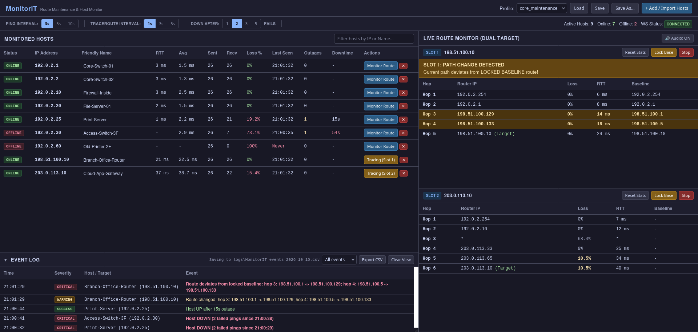

# MonitorIT - Network Operations Dashboard

**MonitorIT** is a lightweight, zero-install portable network diagnostic tool inspired by PingInfoView and WinMTR. It combines multi-host continuous ping monitoring with dual-slot MTR-style continuous traceroutes to detect and alert on route failovers during network maintenance windows.

Designed specifically for restricted enterprise Windows environments, **MonitorIT** calls native Windows IP Helper APIs (`iphlpapi.dll`) via Python `ctypes`, allowing standard non-administrator domain accounts to perform low-level ICMP operations without elevated privileges.

> **Platform:** Windows 10/11 only. The ICMP engine depends on `iphlpapi.dll` and will not start on Linux or macOS.



*Screenshots use made-up documentation addresses (RFC 5737).*

## Key Features

* **Zero Administrator Privileges Required:** Executes unprivileged ICMP Echo Requests and TTL-restricted traceroute sweeps using Windows C APIs (`IcmpSendEcho`).
* **Dual-Slot Live Route Monitor:** Continuously monitors intermediate routing paths for up to two targets simultaneously (stacked 50/50 vertically), with WinMTR-style per-hop loss and RTT statistics.
* **Automated Path Shift & Baseline Alerts:** Visual flashes and audio beeps trigger instantly when intermediate hop IPs deviate from previous sweeps or locked baseline routes. Hops that simply fail to answer (routers rate-limit ICMP replies) are not treated as route changes.
* **Scales to Large Host Lists:** Pings run on a dedicated pool of worker threads, so a profile with 100+ unreachable hosts still completes each round in about one timeout window (1 second) and never delays the traceroute sweeps.
* **Flexible Target Parser:** Imports raw host lists, DNS hostnames, legacy PingInfoView `.txt` exports, tab/comma-separated strings, and CIDR subnet notations (e.g., `198.51.100.0/28`). Lines that cannot be used are listed back to you with the reason.
* **Inline Editing & Row Removal:** Edit friendly host names directly inside table inputs, or click `✕` to drop unreachable firewall targets without resetting active packet statistics.
* **Timestamped Event Log:** Every host outage and recovery (with outage duration), route change, baseline deviation and setting change is recorded with the time it happened, shown in a collapsible strip under the host table, and saved to a daily CSV file in `logs/` for reviews and post-mortems.
* **Per-Host Outage Tracking:** Last seen, outage count, total and longest downtime, and min/avg/max round-trip time for every host, with the current outage counting up live.
* **Configurable Down Detection:** A host is only declared down after a set number of consecutive failed pings (default 2, adjustable in the toolbar), so a single dropped packet does not raise an outage.
* **JSON Profile Persistence:** Save and load custom host groups, ping rates, traceroute intervals and the down threshold (`profiles/*.json`).
* **Survives Page Refreshes:** Running traceroute slots and interval settings live on the server, so a refreshed page or a second browser tab picks them back up.

## Directory Structure

```text
MonitorIT/
├── app/
│   ├── static/
│   │   ├── app.js           # WebSocket connection, table updating & route change alerting
│   │   ├── index.html       # Single-page dashboard layout
│   │   └── style.css        # Dark operational theme
│   ├── __init__.py
│   ├── event_log.py         # Event history: in memory for the dashboard + daily CSV files
│   ├── icmp_engine.py       # Windows iphlpapi.dll Ctypes wrapper (Ping & TTL traceroute)
│   ├── main.py              # FastAPI server, WebSocket endpoints & REST API
│   ├── open_browser.py      # Opens the dashboard once the server is listening
│   └── profile_manager.py   # Profile loader, JSON serializer & raw host text parser
├── logs/                    # Daily event logs, created on first run (not in Git)
├── build/                   # Release zips, made by build_release.bat (not in Git)
├── profiles/
│   └── sample_profile.json  # Default profile loaded at startup
├── python/                  # Optional portable embedded Python (with packages installed)
├── screenshots/             # Pictures for README.md and GETTING-STARTED.html (fake data)
├── tests/                   # Automated tests (see Running the Tests)
│   ├── conftest.py          # Simulated iphlpapi.dll + shared test setup
│   └── test_*.py            # Engine, parser, route logic, hosts, event log, API, route monitor, release build
├── tools/
│   └── build_release.py     # Builds the shareable release zip (see Sharing with Colleagues)
├── build_release.bat        # Double-click to build a release zip
├── GETTING-STARTED.html     # Guide for colleagues, shipped in the release zip
├── LaunchIT.bat             # One-click launcher (portable Python or venv)
├── LEARNING.md              # Learning log: concepts and commands used while building this
├── pytest.ini               # Test settings
├── README.md                # Project documentation
├── requirements.txt         # Python dependencies
├── requirements-dev.txt     # Extra packages for running the tests only
└── TROUBLESHOOTING.md       # Operational issue and bug log
```

## Quick Start & Installation

### Option A: Portable (Embedded Python)

If the `python\` folder (Windows embeddable Python with the requirements installed into `python\Lib\site-packages`) is present, no installation is needed:

1. Double-click `LaunchIT.bat`.
2. The dashboard opens in your default browser at `http://127.0.0.1:8000` as soon as the server is ready.
3. Press **Ctrl+C** in the console window to stop the server.

`LaunchIT.bat` works from any location, including desktop shortcuts. If the server fails to start (for example, the port is already in use), the window stays open so you can read the error.

### Option B: Local Development Setup (Virtual Environment)

1. **Clone or Extract Project:** Ensure the `MonitorIT` directory is on your local machine.
2. **Initialize Python Virtual Environment:**

```powershell
cd MonitorIT
python -m venv venv
.\venv\Scripts\Activate.ps1
pip install -r requirements.txt
```

3. **Launch Application:** Double-click `LaunchIT.bat` (it uses the venv with auto-reload when `python\` is absent), or run from the project folder:

```powershell
uvicorn app.main:app --host 127.0.0.1 --port 8000 --reload
```

4. **Access Dashboard:** Open your browser to `http://127.0.0.1:8000`.

To use a different port, change `set "PORT=8000"` near the top of `LaunchIT.bat`.

## Usage Guide

### 1. Host Monitoring & Inline Editing

- **Filter Hosts:** Type IP addresses or names into the search bar at the top of the host table.
- **Friendly Names:** Click into any **Friendly Name** input box to modify host labels on the fly. Press **Enter** or click away to sync changes.
- **Remove Dead Targets:** Click the red `✕` icon next to any host row to instantly delete it from the active session.
- **Host Status:**

  | Status | Meaning |
  |---|---|
  | **Pending** | Not pinged yet |
  | **Online** | Last ping answered |
  | **Timeout** (amber) | Missed ping(s), but fewer than the **Down After** setting; hover for the count |
  | **Offline** | Reached the **Down After** number of consecutive failures; hover to see when the outage began |

- **Statistics Columns:**

  | Column | Meaning |
  |---|---|
  | **RTT** / **Avg** | Last and average round-trip time; hover either for min / avg / max |
  | **Last Seen** | Time of the most recent reply (date shown if not today). **Never** (red) means no reply since monitoring started |
  | **Outages** | Times the host went down after having been up; hover for the longest outage |
  | **Downtime** | Total time down across all outages. Shown in red and counting up while an outage is in progress; hover for the current outage and when it began |

  An outage runs from the first failed ping to the next reply, and only counts once the **Down After** threshold is reached (a single missed ping is not an outage). A host that has never replied is shown as **Never** rather than accumulating downtime. Statistics reset when a profile is loaded or the host list is replaced.

- **Down After (toolbar):** The number of consecutive failed pings (1, 2, 3 or 5) before a host is marked Offline and an outage is logged. The default is 2. At the default 3-second ping interval, an outage is declared about 3–6 seconds after it begins; use 1 for the fastest detection or 3–5 on lossy links. The setting is saved with the profile.

### 2. Live Continuous Traceroute

- Click **"Monitor Route"** next to any host.
- Target assigned to **Slot 1** or **Slot 2** in the right drawer panel.
- Click **"Lock Base"** to establish a reference path. Any intermediate router IP shift triggers visual flashing and audio beeps (toggleable via **🔊 Audio: ON/OFF**).
- Hops are compared by hop number. A hop that shows `*` (no reply) is never counted as a change, because routers routinely drop or rate-limit these replies. A route that gets longer or shorter is still detected.
- If a hop was silent at the moment you locked the baseline, the first IP that later answers at that hop is adopted into the baseline. Lock the baseline once the path looks complete for the strongest comparison.
- Traceroutes keep running on the server if you refresh or close the page; reopening the dashboard reconnects to them. Use **Stop** to end one.

#### Per-Hop Statistics

Each slot keeps running statistics for every hop, like WinMTR:

- **Loss column:** the share of probes the hop did not answer.
- **Hover over a hop row** for the full figures: sent/received, last / avg / best / worst RTT, jitter (the average change between consecutive replies), and when counting started. The tooltip is a snapshot; move the mouse off and back on to refresh it.
- **Reset Stats** (slot header) restarts that slot's counters, e.g. at the start of a change window. The locked baseline, route alerts, host statistics and the other slot are not affected, and the reset is recorded in the event log.
- A hop's counters also restart on their own when a different router starts answering at that hop (the route change itself is in the event log).
- Only hops up to the destination are counted.

**Reading loss correctly:** routers answer traceroute probes at low priority and often limit how many they send, so an intermediate hop can show loss while the network is fine. MonitorIT classifies it for you:

| Loss shown | Meaning |
|---|---|
| **Amber, bold** | Loss continues through every later hop to the destination: likely real packet loss |
| Grey | Loss at this hop but not at a later hop: usually router rate limiting, not real loss |
| Normal | No loss, or the destination has not been reached so the loss cannot be judged yet |

A hop that never answers at all (shown as `*`, 100% loss, grey) is simply a router configured not to reply to traceroute; traffic still passes through it.

### 3. Event Log

The **Event Log** strip at the bottom of the host table records what happened and when:

| Severity | Events |
|---|---|
| **Critical** | Host DOWN; route deviates from the locked baseline |
| **Warning** | Route changed between sweeps; host unreachable since monitoring started |
| **Success** | Host UP (with outage duration, e.g. `Host UP after 2m 14s outage`); route back on baseline |
| **Info** | App started/stopped, profile loaded, hosts added/removed, route monitoring started/stopped, baseline locked, hop statistics reset, settings changed |

- Click the strip's header to collapse or expand it. While it is collapsed, a red counter shows how many alerts arrived since you collapsed it.
- Drag the strip's bottom-right corner to make it taller or shorter.
- Use the filter to show **Alerts only** (anything but Info), **Hosts**, or **Routes**.
- **Export CSV** downloads the events currently in the strip.
- **Clear View** empties the on-screen list only. The files on disk are never touched.
- Route events name the hops that changed, e.g. `Route changed: hop 3: 10.1.1.2 -> 10.7.7.7`. Like the alerts, they ignore hops that simply did not answer.

**Saved logs:** every event is also appended to `logs\MonitorIT_events_YYYY-MM-DD.csv` (one file per day, opens directly in Excel). When MonitorIT is restarted, today's earlier events are loaded back into the strip.

If a log file is open in Excel, Windows locks it. Events are then held in memory and written as soon as the file is closed, and the strip shows a warning with the number of unsaved events. To review a log while monitoring is running, open a **copy** of the file, or use **Export CSV**.

### 4. Adding & Importing Hosts

- Click **"+ Add / Import Hosts"**.
- Paste target IPs, tabbed lists, or CIDR blocks:

```
10.0.0.1 Core Switch Vlan10
10.0.0.2, Edge Router
198.51.100.0/28
```

- **Hostnames** (e.g., `fileserver01.corp.local File Server`) are resolved to their IPv4 address at import time; the rest of the line becomes the friendly name.
- **CIDR blocks** are limited to a `/22` (1,022 hosts) or smaller to prevent accidental huge imports such as `10.0.0.0/8`.
- **IPv4 only:** IPv6 addresses and subnets are skipped.
- After import, any lines that were skipped (unresolvable names, duplicates, oversized subnets, IPv6) are listed with the reason.
- Leave **"Append to active host list"** checked to keep current metrics running, or uncheck to replace the list entirely.

## REST API Specification

|**Method**|**Endpoint**|**Description**|
|---|---|---|
|`GET`|`/`|Serves main UI dashboard (`index.html`)|
|`GET`|`/api/profiles`|Lists available JSON profile names|
|`GET`|`/api/state`|Active profile, intervals, and traceroute slot assignments|
|`POST`|`/api/profiles/load/{name}`|Loads profile and initializes hosts|
|`POST`|`/api/profiles/save`|Saves host list and settings to profile JSON|
|`POST`|`/api/hosts/parse`|Parses raw text / hostnames / CIDR into structured entries, plus a `skipped` list|
|`POST`|`/api/hosts/set`|Sets or appends host grid (`{ hosts: [...], append: bool }`)|
|`POST`|`/api/hosts/delete`|Deletes a host row by IP (`{ ip: "x.x.x.x" }`)|
|`POST`|`/api/hosts/rename`|Renames host in memory (`{ ip: "x.x.x.x", name: "y" }`)|
|`POST`|`/api/config/intervals`|Configures ping and traceroute timers (seconds, 1–3600) and `down_threshold` (1–10 failed pings)|
|`GET`|`/api/events`|Recent events (`?limit=500`)|
|`GET`|`/api/events/export`|Downloads the events in the dashboard view as CSV|
|`POST`|`/api/events/clear`|Clears the dashboard view (log files are kept)|
|`POST`|`/api/traceroute/start`|Starts continuous worker for target IP|
|`POST`|`/api/traceroute/stop`|Stops worker for target IP|
|`POST`|`/api/traceroute/baseline/lock`|Locks current path as route baseline|
|`POST`|`/api/traceroute/stats/reset`|Restarts a slot's per-hop loss/RTT counters (`{ target_ip: "x.x.x.x" }`)|
|`WS`|`/ws`|Real-time WebSocket feed: `state_sync`, `ping_update`, `traceroute_update`, `event_history`, `events` messages|

### Local-Only Access

The server only answers requests addressed to `127.0.0.1` or `localhost`, and rejects write requests and WebSocket connections from other websites' pages. This stops a web page open in your browser from reading your monitored host inventory or changing settings. To reach the dashboard under another name or address, add it to `ALLOWED_HOSTS` in `app/main.py` (and change `--host` in `LaunchIT.bat`).

## Backup & Profile Management

Profiles are stored as standard JSON files inside the `profiles/` directory:

```json
{
  "profile_name": "Sample Profile",
  "ping_interval": 3,
  "traceroute_interval": 1,
  "down_threshold": 2,
  "hosts": [
    { "ip": "127.0.0.1", "name": "Localhost", "group": "Default" },
    { "ip": "1.1.1.1", "name": "Cloudflare DNS", "group": "Default" }
  ]
}
```

- **Backup:** Copy the `profiles/` folder to back up host lists. Profiles other than `sample_profile.json` are deliberately excluded from Git (see [Version Control](#version-control-git)), so Git is **not** a backup for them.
- **Event logs:** The daily CSV files in `logs/` are also excluded from Git and are never deleted automatically. Copy them somewhere safe if you need them for a review, and delete old ones by hand when no longer needed.
- **Restore:** Paste JSON profiles into `profiles/` and select them from the top bar dropdown menu.
- **Profile names:** Characters Windows does not allow in filenames (`\ / : * ? " < > |`) are replaced with `_` when saving, and the dashboard shows the name actually used.
- **Default profile:** `sample_profile.json` is loaded automatically at startup.

## Running the Tests

The `tests/` folder holds an automated test suite (about 85 tests) that checks MonitorIT's behaviour, including the parts that are easy to break by accident: route comparison that ignores silent hops, per-hop loss classification, the down threshold and outage tracking, event log files, and the localhost security checks. Run it after changing the code and before committing.

**How it works:** MonitorIT's only Windows-specific part is `iphlpapi.dll`. The tests replace it with a simulated network (live and dead hosts, routers, a rate-limited hop, reroutes) and then run the real application against it. That means the suite runs on any computer, Windows or Linux, and gives the same results every time. Nothing in the tests refers to a real network; all addresses come from the reserved documentation ranges.

One test, `test_windows_smoke.py`, instead uses the **real** Windows ICMP layer, pinging and tracing to `127.0.0.1`. It runs only on Windows (it is skipped elsewhere) and is a quick check that the real Windows side still works.

### Setup (once)

The tests need two extra packages, `pytest` and `httpx2`, listed in `requirements-dev.txt`. MonitorIT itself doesn't use them.

**Recommended, if a full Python is installed** (a virtual environment keeps the test packages separate):

```powershell
cd MonitorIT
python -m venv venv
.\venv\Scripts\Activate.ps1
pip install -r requirements-dev.txt
```

**If only the portable `python\` folder is available:**

```powershell
.\python\python.exe -m pip install pytest httpx2
```

This adds the test packages to the portable Python. They don't change how MonitorIT runs, but if you ever share the portable folder with others, start from a clean copy without them.

### Running

From the `MonitorIT` folder (with the venv activated, or using `.\python\python.exe` in place of `python`):

```powershell
python -m pytest                  # Everything: about 25-40 seconds
python -m pytest -m "not slow"    # Skip the live route-monitor tests: a few seconds
python -m pytest tests\test_event_log.py   # One file
python -m pytest -k outage        # Tests whose names contain "outage"
```

A good run ends with a line like `83 passed, 1 skipped` on Linux. On Windows the smoke test runs and the release-build tests are skipped (they fake `python.exe` with a shell script), so expect `72 passed, 12 skipped`. Any `FAILED` line names the test that broke and shows what it expected.

The live route-monitor tests (`slow`) take longest because they run real one-second traceroute sweeps.

### What the tests don't cover

- **Real network behaviour.** Only the Windows smoke test touches the real ICMP layer, and only against `127.0.0.1`. Testing against real targets on the Windows PC remains the final check.
- **How the dashboard looks.** The tests check the data the server sends, not the browser display, so layout, tooltips and colours still need a look on screen.

## Sharing with Colleagues (Release Build)

To give MonitorIT to colleagues, build a release zip rather than copying your working folder (which holds your own profiles, logs, tests and Git history).

1. On the Windows PC (where the working `python\` folder is), double-click **`build_release.bat`**.
2. The zip appears in `build\MonitorIT-YYYY-MM-DD.zip`. Share that file.

What goes in is an **allowlist** in `tools/build_release.py` (`INCLUDE`): the `app\` folder, the portable `python\` folder, `LaunchIT.bat`, `GETTING-STARTED.html`, `screenshots\` and `profiles\sample_profile.json`. Anything not listed stays out, so a new folder can never slip in by accident. Before writing the zip, the script:

- **refuses to build** if a forbidden file would be included (CSV files, event logs, `tests`, `.git`, `CLAUDE.md`, `LEARNING.md`, secrets) or a required file is missing;
- **leaves out the test packages** (`pytest`, `httpx2` and their helpers, listed in `DEV_PACKAGES`) if they were installed into `python\`;
- **runs a smoke test**: the bundled Python imports the app from the staged copy, so a broken bundle is caught before it is shared.

Run `python\python.exe tools\build_release.py --list` to see the contents without building. On Linux the script builds but skips the smoke test (it needs `python.exe`).

`GETTING-STARTED.html` is the colleagues' guide: what MonitorIT is, how to start it, how to read the screen, and troubleshooting. Update it when something a user needs to know changes.

## Version Control (Git)

The project is a **local-only** Git repository (no remote), used to track changes to the app and roll back if something breaks. Commits use the GitHub noreply address `673674+RedDirtBits@users.noreply.github.com`, which is set for this repository only.

### What Is and Isn't Tracked

| Tracked | Ignored (see `.gitignore`) |
|---|---|
| `app/` source, `tests/`, `tools/`, launchers, docs, `screenshots/`, `requirements*.txt`, `pytest.ini` | `python/` portable runtime (64 MB of binaries; reinstallable) |
| `profiles/sample_profile.json` | All other `profiles/*.json` (internal IPs and device names) |
| `.gitignore` | `logs/` event logs (internal IPs and device names) |
| | `build/` release zips, `scratch/` experiments, `venv/`, `__pycache__/`, `.pytest_cache/`, editor folders |

### First-Time Setup on a New Machine

If you copy the project folder (including the hidden `.git` folder) to another PC, set the identity and line-ending behavior for this repository once:

```powershell
cd MonitorIT
git config user.name "RedDirt"
git config user.email "673674+RedDirtBits@users.noreply.github.com"
git config core.autocrlf false
```

The files use Windows (CRLF) line endings and are stored that way in the repository. `core.autocrlf false` stops Git from converting them, which would otherwise make every line of a file show as changed.

### Everyday Workflow

```powershell
git status                      # What has changed since the last commit?
git diff                        # Show the exact line changes
git add -A                      # Stage all changes (new, modified, deleted files)
git commit -m "Describe what changed and why"
git log --oneline               # List commits, newest first
```

Commit after each working change, so there is always a known-good point to return to. Running `python -m pytest` first (see [Running the Tests](#running-the-tests)) confirms the change didn't break anything.

### Undoing Mistakes

```powershell
# Throw away uncommitted edits to one file (restore it from the last commit)
git restore app/main.py

# Throw away ALL uncommitted edits (cannot be undone)
git restore .

# Unstage a file you added by mistake (keeps your edits)
git restore --staged app/main.py

# See what a past commit changed
git show <commit-id>

# Bring back one file as it was in an earlier commit
git checkout <commit-id> -- app/static/app.js

# Undo a whole commit by adding a new commit that reverses it (history is kept)
git revert <commit-id>
```

`<commit-id>` is the short code shown by `git log --oneline` (e.g., `5056c60`).

### Trying Risky Changes on a Branch

```powershell
git switch -c experiment        # Create and switch to a new branch
# ...edit, test, commit as usual...
git switch main                 # Back to the working version (experiment is untouched)
git merge experiment            # Keep the experiment's changes, or...
git branch -D experiment        # ...throw the experiment away
```

### Marking Known-Good Versions

```powershell
git tag v1.0 -m "Used during maintenance window"
git tag                         # List tags
git checkout v1.0 -- .          # Restore every tracked file to that version
```

### Tracking a New Profile Anyway

Profiles are ignored by default. To version a specific profile that contains nothing sensitive, add an exception line to `.gitignore` below the existing ones:

```gitignore
!profiles/My_Profile.json
```

> **Before ever pushing this repository to GitHub:** the first commit (`c123f8d`) contains two work profiles from before they were ignored. Ignoring a file does not remove it from earlier commits, so those must be scrubbed from history before any push.
